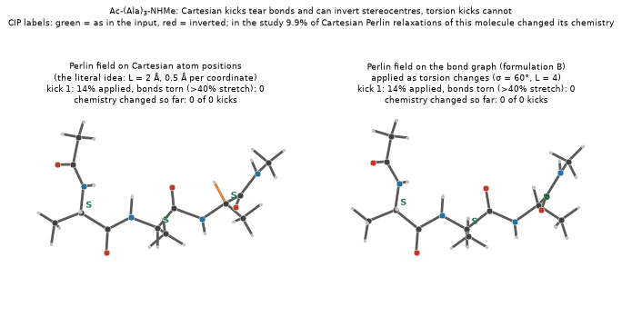
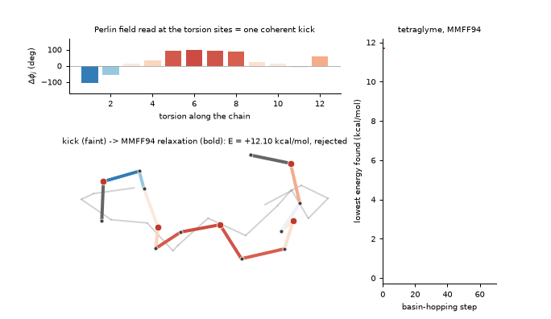
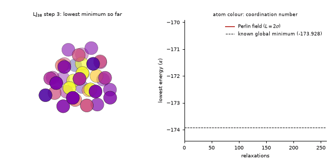
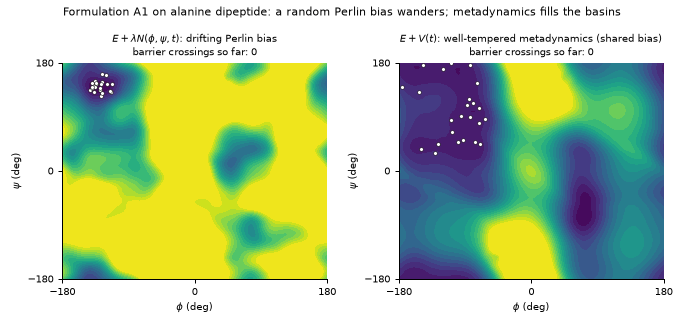
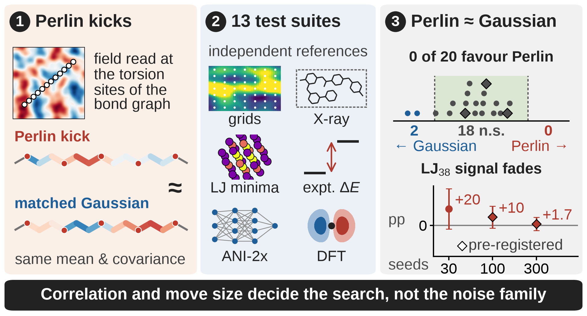
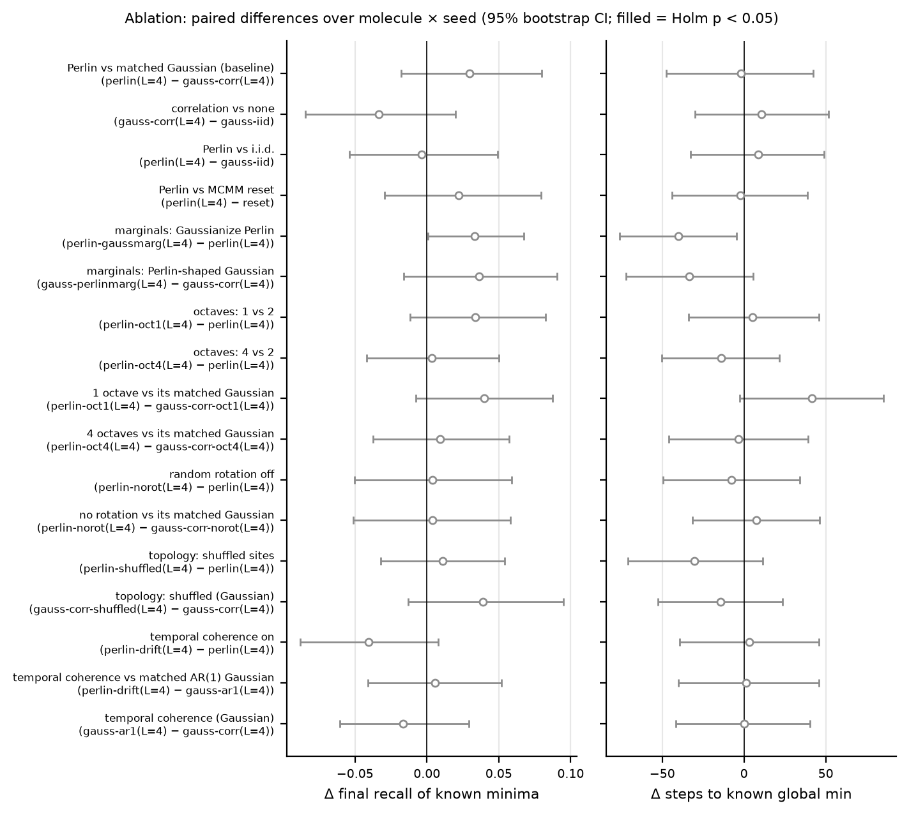
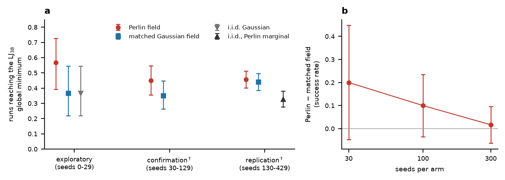
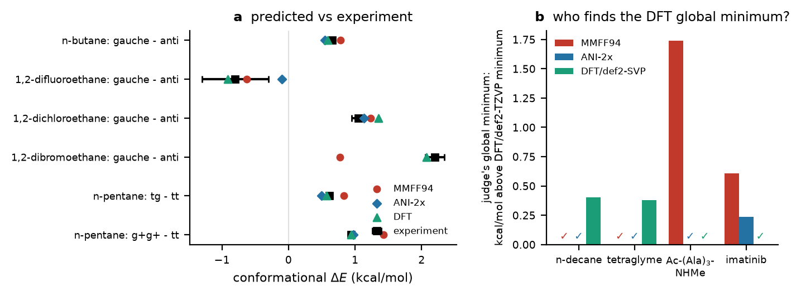

# Perlin noise vs. matched Gaussian noise in molecular structure search

[](LICENSE)


**Can Perlin noise, the smooth random texture of computer graphics, help find the stable structures of
molecules?** This repository holds the code, all results and the DFT inputs of a controlled test of that
idea. The key control is a Gaussian kick with **exactly the same correlation** as the Perlin kick.

> **Verdict.** A Perlin field read over a molecule's bond graph gives valid, cheap, coherent moves for basin
> hopping. Across 13 test suites it **never significantly beat its correlation-matched Gaussian**. Both
> exploratory signals in its favour **failed pre-registered confirmation** on fresh seeds. The correlation
> kernel and the move size decide search performance, not the noise family.

Code and results for: S. Banerji Seal and V. R. K. Ganapathy, *Perlin Noise Does Not Beat Correlation-Matched
Gaussian Noise in Molecular Structure Search* (IISER Kolkata, 2026; manuscript).

---

## See it

### 1 · Shaking atoms tears molecules apart; a field read on the bond graph does not



The literal idea is to displace every atom by a Perlin field, $\mathbf R \to \mathbf R + \eta\,\mathbf N(\mathbf R)$
(left; Ac-(Ala)₃-NHMe, $L = 2$ Å, 0.5 Å per coordinate). This stretches and tears bonds (dotted red). After
MMFF94 relaxation a stereocentre can come back inverted (red CIP label). In the study, **9.9% of these
relaxations changed the molecule's chemistry**.

Reading the same kind of field on the molecule's bond graph and applying it as torsion changes (right) cannot
do this. Bond lengths and stereocentres are untouched by construction.

### 2 · A Perlin field becomes one coherent kick; MMFF94 relaxes it; Metropolis decides



### 3 · Basin hopping with a Perlin displacement field reaches the LJ₃₈ global minimum



### 4 · A Perlin *energy bias* wanders; metadynamics fills the basins



Every frame comes from the package's own code and data (`scripts/make_animations.py`).

---

## Quick start

You need [uv](https://docs.astral.sh/uv/getting-started/installation/). It installs Python 3.12 and the exact
locked dependencies by itself.

```bash
git clone https://github.com/Shuvam-Banerji-Seal/perlin-noise-molecular-search.git
cd perlin-noise-molecular-search
bash scripts/quickstart.sh
```

`quickstart.sh` takes a few minutes. It installs everything, runs the unit tests and runs a 10-second
benchmark. It then regenerates the figures from the shipped results. You can also run each step on its own:

```bash
uv sync --extra plot                         # environment (core + plotting)
uv run pytest -q                             # unit tests
uv run perlin-mole molecules                 # built-in benchmark molecules
uv run perlin-mole bench --molecules decane --seeds 4 --steps 100 --corr-lengths 4 --out runs/demo
uv run perlin-mole bench --molecules "CCOC(=O)CCCC(=O)OCC" --seeds 4 --steps 100 --out runs/mine   # any SMILES
uv run --extra plot python scripts/make_figures.py      # every figure, from results/
uv run --extra plot python scripts/make_animations.py   # the four animations above
bash scripts/fetch_raw_results.sh            # the 13 large raw result files (GitHub release assets)
```

A benchmark writes `summary.md` (coverage, gap to the best minimum, hit rate, acceptance), `report.json` and
`coverage.png` to its `--out` folder. It compares Perlin, its matched Gaussian, independent kicks, an MCMM-style
reset and ETKDG embedding at an equal budget of MMFF94 relaxations.

---

## The algorithms

### Perlin fields

Periodic gradient noise on $\mathbb R^d$ uses pseudo-random unit gradients $\mathbf g_{\mathbf c}$ at lattice
points and the quintic fade $f(t)=6t^5-15t^4+10t^3$:

$$N(\mathbf x)=\sum_{\mathbf c\in\{0,1\}^d}\Big(\prod_{i=1}^d w_i(c_i)\Big)\,\mathbf g_{\lfloor\mathbf x\rfloor+\mathbf c}\cdot(\mathbf x-\lfloor\mathbf x\rfloor-\mathbf c),$$

with $w_i(1)=f(u_i)$, $w_i(0)=1-f(u_i)$ and $\mathbf u = \mathbf x-\lfloor\mathbf x\rfloor$. Fractal noise sums
octaves, $F(\mathbf x)=\sum_{o<O} 0.5^{o}N(2^o\mathbf x)$ (two octaves by default). Gradients are analytic.

### Formulation A: a Perlin landscape over torsion space (ruled out)

- **A2, gradient moves.** The move is $\Delta\boldsymbol\phi=-\eta\nabla F$ on the torsion torus. For any
  stationary, reflection-symmetric field the gradient components are **uncorrelated** (Proposition 1), so these
  moves are not collective. Evaluating the field costs $\Theta(k\,2^k)$ in $k$ torsions (Proposition 2).
- **A1, energy bias.** Sampling $E+\lambda F$ is a static, random relative of metadynamics. Reweighting
  loses effective sample size as $e^{-\beta^2\lambda^2 v}$ (Proposition 5). On the alanine dipeptide a static
  bias never crossed the barrier. A drifting bias crossed no more often than its matched drifting Gaussian
  field, with worse free energies (animation 4).

### Formulation B: a Perlin field over the molecule (valid, coherent, cheap)

1. **Embed** each rotatable torsion $j$ at a point $\mathbf x_j\in\mathbb R^3$ by classical multidimensional
   scaling of bond-graph distances between torsions. This depends on the bond graph only.
2. **Kick.** Draw a Haar-random rotation $R$, an offset $\mathbf o$ and a sign $s$, independently of the state:

   $$\Delta\phi_j=\sigma\,s\,F(R\mathbf x_j/L+\mathbf o)/\kappa,\qquad j=1,\dots,k,$$

   where $\kappa$ normalises the marginal standard deviation to $\sigma$. Neighbouring torsions get similar
   kicks, with correlation decaying over $L$ bonds.
3. **Validity.** The kick law is state-independent and symmetric, so Metropolis acceptance satisfies detailed
   balance (Proposition 3).

### The null model: a correlation-matched Gaussian

Let $K=\mathrm{Corr}(\Delta^{\mathrm P})$ be the correlation matrix of the Perlin kicks. Then
$\Delta^{\mathrm G}\sim\mathcal N(\mathbf 0,\sigma^2K)$ has **the same mean and covariance** (Proposition 4).
The two can differ only in cumulants of order four and higher. Perlin minus matched Gaussian therefore
isolates what is specific to Perlin noise. Matched Gaussian minus independent kicks isolates the effect of
correlation itself.

### Search and judges

```text
x, E ← relax(start)                                   # MMFF94 local minimisation
repeat budget times:
    Δ  ← proposal.sample()                             # Perlin | matched Gaussian | i.i.d. | reset
    x', E' ← relax(apply_torsion_changes(x, Δ))        # exact torsion edits, then MMFF94
    archive x' if it is a new minimum                  # symmetry-aware heavy-atom RMSD + energy
    accept with probability min(1, exp(-(E' - E)/kT))  # basin hopping
```

- **Clusters and Cartesian kicks.** For Lennard-Jones clusters and Cartesian kicks, three Perlin fields (one
  per Cartesian component) displace the atoms. The control is a Gaussian random field with Perlin's
  correlation function.
- **Judges.** Stable structures are judged by MMFF94 (RDKit), then re-judged with ANI-2x (TorchANI) and with
  B3LYP-D3(BJ)/def2-SVP and def2-TZVP DFT on the GPU (GPU4PySCF).

---

## Results at a glance

<p align="center">
  <br>
  <em>Graphical abstract. (1) A Perlin field read at the torsion sites gives one smooth kick; the matched Gaussian has the same mean and covariance. (2) Thirteen test suites against independent references. (3) None of the 20 contrasts favours Perlin, and the most promising signal (LJ₃₈) fades under pre-registered tests.</em>
</p>

| Test suite | Reference | Perlin − matched Gaussian |
|---|---|---|
| Flexible organics (decane, tetraglyme, Ac-(Ala)₃-NHMe, imatinib), σ = 30°/60°/120° | pooled low-energy minima | 28 comparisons; smallest Holm-adjusted P = 0.88; the only nominally significant differences favour the Gaussian |
| 16-variant ablation, 5 molecules × 20 seeds | exhaustive torsion grids | recall +0.030 [−0.018, +0.080]; steps to global minimum −2 [−48, +42] |
| 16 experimental X-ray conformations (PDB, COD) | experiment | min. RMSD −0.010 Å [−0.039, +0.017]; ETKDG embedding beats every basin-hopping proposal |
| C₁₀H₂₂ isomers, diastereomers, enantiomers | exhaustive grids | no Perlin advantage (diastereomers favour the Gaussian) |
| Cartesian kicks, unrelaxed MC, 12–18-torsion molecules | grids / jump statistics | no difference |
| LJ₃₈ (exploratory 17/30 vs 11/30) | known global minimum | **pre-registered** confirmation 45/100 vs 35/100, P = 0.19; replication 137/300 vs 132/300, P = 0.74 |
| Low-temperature hint | grids | **pre-registered** confirmation −0.010 [−0.038, +0.019] |
| Perlin energy bias (A1) vs well-tempered metadynamics | exact free energy | metadynamics wins on speed and accuracy |
| Re-judging with ANI-2x and DFT | B3LYP-D3(BJ)/def2-TZVP | proposal comparison unchanged; the most stable conformer of drug-like molecules depends on the energy model |

<p align="center">
  <br>
  <em>No ingredient of Perlin noise matters beyond its correlation (ablation, 17 paired contrasts, Holm-corrected).</em>
</p>

<p align="center">
  <br>
  <em>The most promising signal, LJ₃₈, shrank from 20 to 10 to 1.7 percentage points as the number of seeds grew.</em>
</p>

<p align="center">
  <br>
  <em>Which energy model identifies the stable structure? DFT (def2-TZVP) is the most accurate judge against gas-phase experiment.</em>
</p>

---

## Repository layout

```text
src/perlin_mole/      the package
  proposals.py          torsion-space proposals: Perlin (formulation B), matched Gaussian, i.i.d., reset, ablation variants
  landscape.py          formulation A: Perlin landscape over torsion space (cost, gradient decorrelation)
  bias2d.py             formulation A1: Perlin bias on the alanine-dipeptide surface vs metadynamics
  chem.py, search.py    molecules, torsions, MMFF94 judge; basin hopping and the symmetry-aware minima archive
  benchmark.py, cli.py  equal-budget benchmark and the `perlin-mole` command
  ablation.py, validate.py, export.py   ground-truth scoring, ablation statistics, pooled discoveries
  experimental.py, isomers.py, conformational.py   experimental structures, isomers/enantiomers, gas-phase energies
  clusters.py, cartesian.py, rigid_mc.py           Lennard-Jones clusters, Cartesian kicks, unrelaxed MC
  ml_judge.py           ANI-2x judge (TorchANI)
scripts/              one runner per test suite, DFT (run_dft.py), figures, animations, reproduce.sh
tests/                unit tests (noise lattice zeros/periodicity/analytic gradients, torsion edits, RMSD, ...)
data/                 experimental structures (PDB/COD, SDF + manifest) and gas-phase conformer energies
results/              every result of the study (JSON, Markdown summaries, SDF, grids, run logs, pre-registrations)
figures/              figures regenerated from results/ by scripts/make_figures.py
docs/animations/      the animations above
```

## Results and data

- **`results/<suite>/`** holds `report.json` or `<suite>.json` (all numbers), `summary.md` (readable tables)
  and the run logs for every test suite.
- **Pre-registrations.** The analysis plans of the confirmatory tests were fixed before the fresh seeds were
  run: `results/clusters_confirm/PREREGISTRATION.md`, `results/clusters_replication/PREREGISTRATION.md` and
  `results/lowT_confirm/PREREGISTRATION.md`.
- **`results/discoveries/sdf/`** has every low-energy MMFF94 minimum found, pooled over all runs and the
  exhaustive grids. These SDF files are also the geometries judged by DFT.
- **`results/validation/` and `results/isomers/grids/`** hold the exhaustive torsion-grid references.
- **`results/dft/`** holds the DFT results:
  - D1: gas-phase conformer energies at def2-TZVP geometries.
  - D2: def2-SVP single points on every discovered minimum.
  - D3: def2-TZVP global-minimum arbitration.
- **Large raw files.** The 13 raw per-run files of 10 MB or more (`raw.pkl` and the full tetraglyme grid, 0.8 GB
  in total) are assets of the [v1.0.0 release](https://github.com/Shuvam-Banerji-Seal/perlin-noise-molecular-search/releases/tag/v1.0.0).
  `bash scripts/fetch_raw_results.sh` downloads them and checks them against `results/RAW_RESULTS.sha256`.
- **`data/experimental/`.** The manifest gives each structure's PDB or COD identifier, resolution or R
  factor, and SMILES. The study uses the 16 molecules listed in `results/experimental/experimental.json`.
  `scripts/fetch_experimental.py` re-fetches the structures from the RCSB PDB and the COD.

## Reproducing everything

`bash scripts/reproduce.sh` regenerates every result and figure from scratch. It takes about 8–10 h on a
24-core node with one NVIDIA A100, and every step uses all cores. Single suites:

| Suite | Command |
|---|---|
| Flexible organics (S1) | `uv run perlin-mole bench --molecules decane,tetraglyme,ala3,imatinib --seeds 10 --steps 500 --corr-lengths 2,4,8 --sigma 60 --out results/sigma60` |
| Alanine dipeptide, grids, 16-variant ablation | `uv run python scripts/validate_alanine.py && ./scripts/run_ablation.sh && uv run python -m perlin_mole.ablation results/ablation` |
| Experimental structures | `uv run python scripts/run_experimental.py --jobs $(nproc)` |
| Isomers and enantiomers | `uv run python scripts/run_isomers.py conformational enantiomers diastereomers constitutional --seeds 10 --steps 300` |
| Lennard-Jones clusters | `uv run python scripts/run_clusters.py --jobs $(nproc) --seeds 30` |
| LJ₃₈ confirmation (pre-registered) | `uv run python scripts/run_lj38_confirm.py $(nproc)` |
| Regime hunt, temperature, Cartesian, 2-D bias | `./scripts/run_hunt.sh`, `scripts/run_hunt_kt.py`, `scripts/run_cartesian.py`, `scripts/run_bias2d.py` |
| ANI-2x judge (GPU) | `uv run --extra gpu --extra plot python scripts/run_ml_judge.py` |
| DFT judge (GPU) | `uv run --extra dft --extra gpu python scripts/run_dft.py d1 d2 d3` |

**DFT settings** (`scripts/run_dft.py`):

- Functional: B3LYP-D3(BJ) with density fitting, SCF convergence 10⁻⁹ Eh.
- D1: geomeTRIC optimisation (at most 200 steps) at def2-TZVP.
- D2: def2-SVP single points at the MMFF94 geometries in `results/discoveries/sdf/`.
- D3: def2-TZVP single points for the global-minimum candidates.
- The `dft` extra installs GPU4PySCF for CUDA 13. For a CPU run, import `rks` from `pyscf.dft` instead of
  `gpu4pyscf.dft`.

**Software.** RDKit 2026.03.6, NumPy 2.5.3, SciPy 1.18.1, PyTorch 2.13 with TorchANI 2.9.0, PySCF 2.14.0 with
GPU4PySCF 1.8.1 and geomeTRIC 1.1.1. The versions are pinned in `uv.lock`. Every run is seeded by (seed,
method).

## Citation

See [`CITATION.cff`](CITATION.cff). Please cite the article once it is published:

> S. Banerji Seal and V. R. K. Ganapathy, *Perlin Noise Does Not Beat Correlation-Matched Gaussian Noise in
> Molecular Structure Search*, Indian Institute of Science Education and Research Kolkata, 2026.

## License

[GNU General Public License v3.0 or later](LICENSE). © 2026 Shuvam Banerji Seal and V. Rupendra Krishna Ganapathy.
